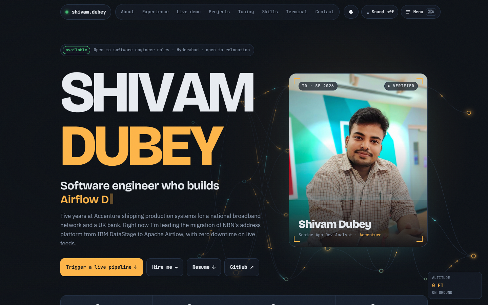

# Shivam Dubey · Portfolio

**Live site → [shivam8897.github.io](https://shivam8897.github.io)**

An interactive portfolio for **Shivam Dubey**, a software engineer with 5 years at Accenture building data pipelines, Oracle/PL-SQL systems and release automation. The theme is **"mission control for data pipelines"**. It joins two worlds: aeronautics (Shivam's engineering degree) and data orchestration (his day job).



The whole site is **one `index.html` file** of plain HTML, CSS and JavaScript. It uses no framework, needs no build step and has no dependencies to install.

---

## Highlights

| Section | What it does |
|---|---|
| **Hero** | Name letters rise in and get thinner and turn amber as the cursor comes near. A typed role line cycles through phrases, and the stat counters animate up. A holographic **photo card** builds itself out of thousands of pixel particles. An animated pipeline network (a DAG) runs in the background, and the layers move in 3D with the mouse. |
| **About** | Story from aeronautical engineering to software, plus a boarding-pass card that tilts in 3D with an animated plane on its route. |
| **Experience** | Timeline of three roles at Accenture. A progress line fills as you scroll. |
| **Live demo** | An **Airflow-style pipeline you can run** (`tams_address_refresh`). Tasks run in dependency order, one of them sometimes fails and retries by itself, and a *chaos mode* makes failures more likely. Each run writes a live log. |
| **Projects** | Five project cards (NBN TAMS & ELMS, TSB Capital & Impairment, Securitization, Database CI/CD) with 3D tilt and a spotlight that follows the cursor. |
| **Query tuning** | The same SQL shown **before and after** tuning, with animated EXPLAIN PLAN rows and cost bars. |
| **Skills** | Click a skill to highlight the projects that used it. Certifications are listed below. |
| **Terminal** | A pretend shell you can type in: `help`, `whoami`, `projects`, `resume`, `contact`, `airflow`, `sudo hire shivam`… Use ↑/↓ for command history. |
| **Contact** | Email (copy it, open your mail app, or open Gmail), LinkedIn, GitHub, and the resume download. |

### Effects & interactions
- **Paper-plane cursor** that turns to face the direction you move, leaves a faint trail, and grows over anything clickable.
- **Warp jump:** light-speed streaks when you jump to a section far down the page.
- **Day / night theme**, revealed as a growing circle from the toggle button. Press `T` to switch, and the choice is remembered.
- **Command menu:** press `Ctrl/⌘ + K` to jump to sections, switch theme, trigger the pipeline or download the resume.
- **Sound effects** made in the browser with the Web Audio API (there are no audio files). They're off by default.
- Film grain, scroll progress bar, an "altimeter" scroll gauge, magnetic buttons, click ripples, word-by-word heading reveals.
- Easter eggs: the Konami code (↑↑↓↓←→←→BA) or `sudo hire shivam` in the terminal.

---

## Tech used

| Area | Technology |
|---|---|
| Markup | HTML5 (semantic sections, ARIA roles and live regions) |
| Styling | CSS3: custom properties for the colour tokens, Grid and Flexbox, `color-mix()`, `clamp()` for fluid type, keyframe animations, `backdrop-filter`, `mix-blend-mode`, the View Transitions API |
| Scripting | Vanilla JavaScript (ES2020) in one self-contained function, no libraries |
| Graphics | Canvas 2D (pipeline network, cursor trail, photo particles, warp streaks, confetti) and inline SVG (pipeline graph, icons, paper plane) |
| Audio | Web Audio API (synthesised sound effects) |
| Browser APIs | IntersectionObserver, History API (shareable `#section` links and a working Back button), Clipboard API, `matchMedia` (theme and reduced motion), `localStorage` |
| Fonts | [Bricolage Grotesque](https://fonts.google.com/specimen/Bricolage+Grotesque) (variable font whose weight is animated), [IBM Plex Sans](https://fonts.google.com/specimen/IBM+Plex+Sans), [JetBrains Mono](https://fonts.google.com/specimen/JetBrains+Mono), all from Google Fonts |
| Hosting | GitHub Pages |
| Testing | Headless Chrome via Puppeteer: link checks, layout checks at 400, 768, 1024, 1280 and 1440px, and console-error checks. Used only during development; nothing from it ships with the site. |

### Accessibility & performance
- Respects **`prefers-reduced-motion`**, which turns the animations and particle effects off.
- Visible focus rings, labelled controls, keyboard-reachable pipeline tasks, and `aria-live` regions for the log and results.
- Responsive from 400px phones up to wide desktops. On small screens the nav becomes a swipeable row.
- On touch devices the custom cursor turns off and the normal cursor stays.
- The only external requests are Google Fonts. There is no tracking or analytics.

---

## Project structure

```
.
├── index.html                  # the entire site (HTML + CSS + JS)
├── assets/
│   ├── shivam.jpg              # profile photo
│   ├── Shivam_Dubey_Resume.pdf # resume served by the download buttons
│   └── preview.png             # screenshot used in this README
├── .nojekyll                   # tells GitHub Pages to serve the files as they are
└── README.md
```

Inside `index.html`, the parts appear in this order: colour tokens (night, then day) → layout and component styles → page sections → one script with separate blocks for the theme, sound, helpers, hero, canvases, cursor, scroll, pipeline runner, SQL tuner, skills, terminal and command menu.

---

## Run it locally

No install is needed. Clone the repo and serve the folder:

```bash
git clone https://github.com/shivam8897/shivam8897.github.io.git
cd shivam8897.github.io
python -m http.server 8000      # or: npx serve .
```

Then open <http://localhost:8000>.

> You can also double-click `index.html`. Everything works except the photo's particle build-up, because browsers block reading image pixels from `file://` pages. The photo still shows normally.

## Deploy

The site is hosted on **GitHub Pages** from the `main` branch. Pushing to `main` updates <https://shivam8897.github.io> within a minute or two.

## Customising

- **Colours:** change the tokens at the top of the `<style>` block. Every colour is set three times (night, system-light, forced-light), so change all three.
- **Resume:** replace `assets/Shivam_Dubey_Resume.pdf` and keep the same file name.
- **Photo:** replace `assets/shivam.jpg`. The card crops it with `object-position: 50% 26%`.

---

## Contact

- **Email:** shivamdubey012@gmail.com
- **LinkedIn:** [in/shivam-dubey012](https://www.linkedin.com/in/shivam-dubey012/)
- **GitHub:** [@shivam8897](https://github.com/shivam8897)

© 2026 Shivam Dubey. The code may be used for learning; please don't reuse the personal content (text, photo, resume).
